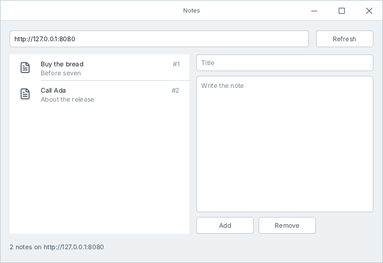

# Notes: a service, a tool and an app

A small program of each of the three kinds that Cromo is made for, in one project of about 330 lines with nothing but the standard library:

- `notes-server`, a **backend**: a service over HTTP that keeps the notes in a file of JSON;
- `notes`, a **tool** for the terminal that talks to the service;
- `notes-app`, an **app** with a window, on Windows and Linux, and on Android from the same code.



## The files

| | |
|---|---|
| [cromo.mod](cromo.mod) | The project and its three executables |
| [store.cro](store.cro) | The notes and where the service keeps them, with a test |
| [api.cro](api.cro) | The service as its clients see it: a function for each request |
| [cmd/server.cro](cmd/server.cro) | The service: the routes, and the store in a `Mutex` |
| [cmd/notes.cro](cmd/notes.cro) | The tool |
| [cmd/app.cro](cmd/app.cro) | The app: its handlers start a task for each request, and never wait for the network |

## Trying it

In this folder, in a terminal:

```sh
cromo run notes-server
```

and in another one:

```sh
cromo run notes -- add "Buy the bread" "Before seven"
cromo run notes -- list
cromo run notes-app
cromo test
```

`cromo build` writes the three executables here. Each one is a single file without dependencies; the service for a Linux server is built on Windows too:

```sh
cromo build --release --target linux notes-server
```

## What to look at

- **JSON without code.** `Note` and `NewNote` in `store.cro` are plain structs: the compiler writes their conversion to JSON and back.
- **The lock that cannot be forgotten.** The requests run at the same time, each on a task. The store is a `thread.Mutex<Store>`, and its data are reached only inside `lock`: a handler that touched them without it would not compile.
- **A window that does not freeze.** A handler of the app reads the text boxes, starts a task and returns. The task asks the service and changes the components, which any thread can do.
- **What Cromo does not have.** The app keeps the notes that it shows in a `thread.Shared`, a handle to a value with its lock, where another language would keep a reference: [What Cromo checks, and what it does not](../../book/en/appendix-safety.md) says why, and what it costs.
